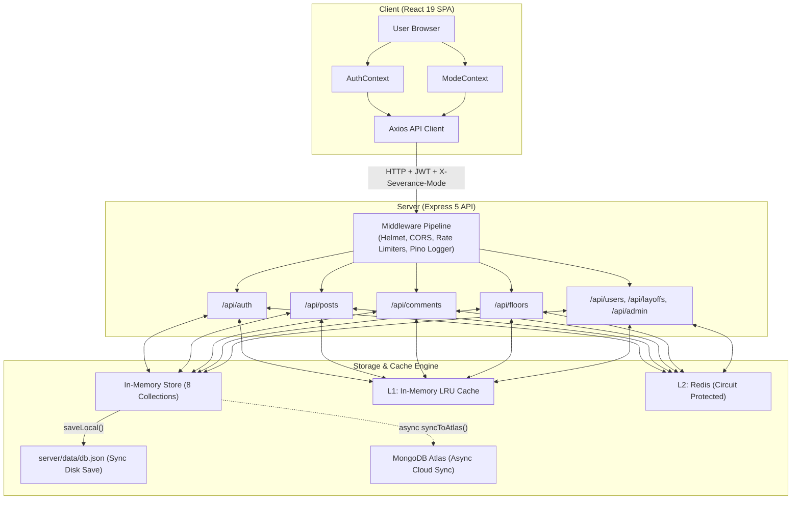
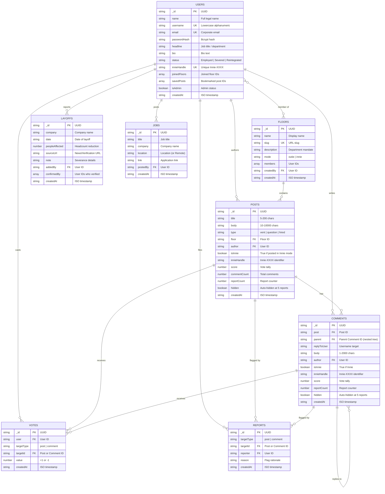
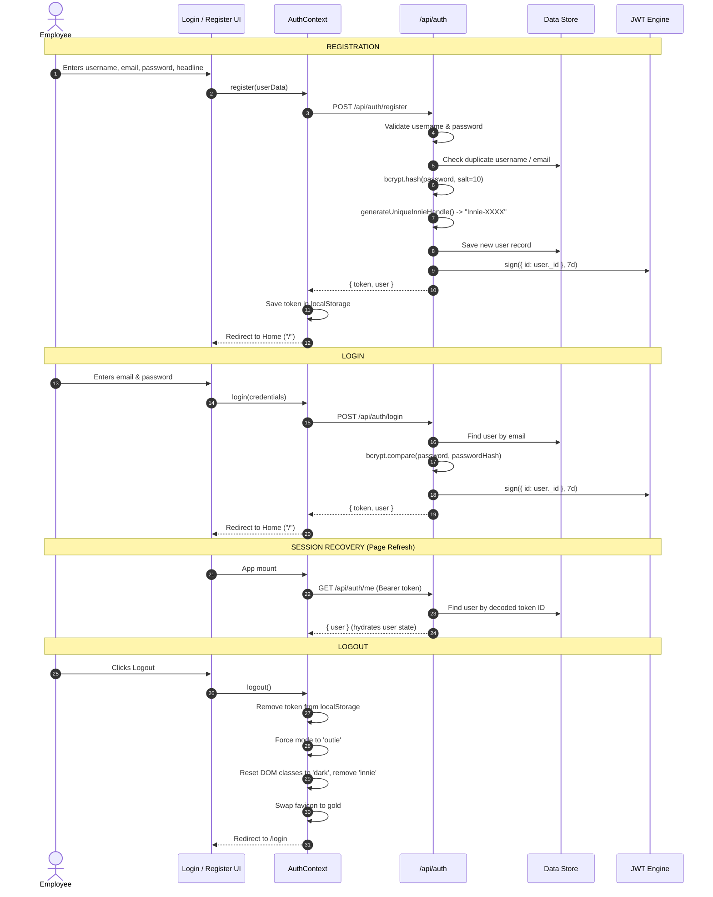
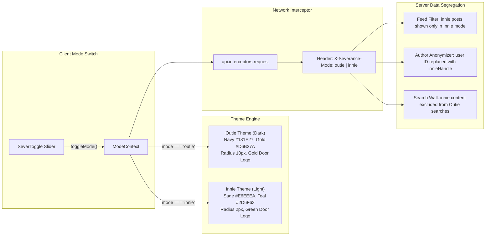
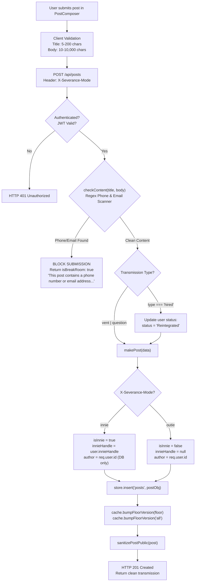
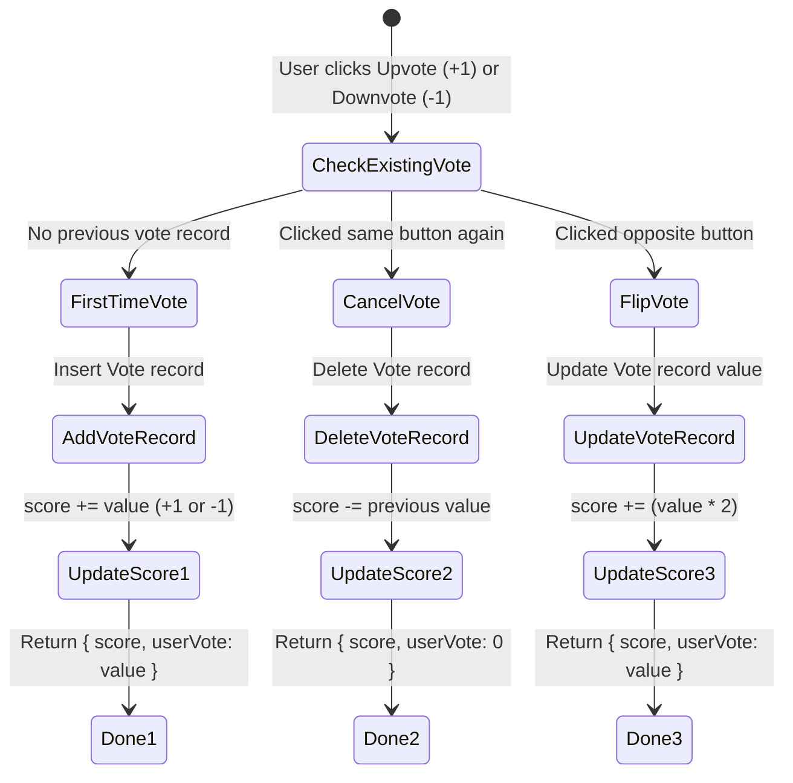
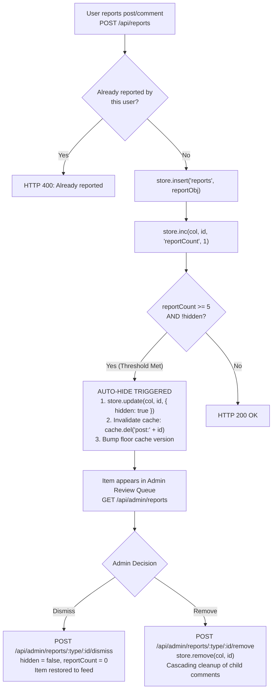
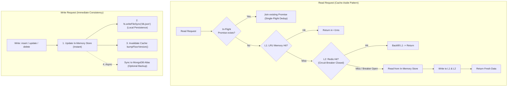

# PROJECT SEVERANCE — Technical Architecture & Development Report

**Project**: Linked Out (`PROJECT-SEVERANCE`)  
**Type**: Full-Stack MERN Corporate Network & Severed Floor Forum  
**Repository**: [amangodara569/PROJECT-SEVERANCE on GitHub](https://github.com/amangodara569/PROJECT-SEVERANCE.git)  
**Date**: November 23, 2026  

---

## 1. What is Linked Out? (The Concept in Plain English)

**Linked Out** is a full-stack corporate social network inspired by the Apple TV+ series *Severance*. It is built around a **dual-identity architecture**:

- **Outie Mode (The Upper Floors)**:
  - The user's public corporate persona.
  - Theme: Corporate dark navy (`#181E27`), charcoal panels (`#1F2630`), and warm executive golden-amber accents (`#D6B27A`, `10px` rounded corners).
  - User profile shows real username (`@username`), full name, corporate title, employment status, and post history.
- **Innie Mode (The Severed Floor)**:
  - The anonymous, severed workplace identity.
  - Theme: Sterile clinical mint-green (`#E6EEEA`), pale panels (`#F1F6F3`), and surgical teal accents (`#2D6F63`, sharp `2px` corners).
  - Complete anonymity: real usernames and user IDs are stripped from transmissions. Posts display only a system-generated cryptographic identifier (e.g. `Innie-4821`).

---

## 2. Technology Stack

| Layer | Technology | Version | Purpose |
| :--- | :--- | :--- | :--- |
| **Frontend Framework** | React | `^19.3.1` | Concurrent component rendering, lazy-loaded page routes |
| **Routing** | React Router DOM | `^7.18.5` | Client-side routing, protected auth guards |
| **Styling** | Tailwind CSS | `^4.3.3` | Utility styling with CSS variable switching |
| **Typography** | IBM Plex Sans & Mono | `^5.3.0` | Severance retro-futuristic & corporate fonts |
| **Icons** | Lucide React | `^1.73.0` | Minimalist SVG icons |
| **HTTP Client** | Axios | `^1.21.0` | Request/response interceptors for auth & severance mode |
| **Build Tool** | Vite | `^8.3.5` | Sub-second dev server and optimized production bundler |
| **Backend Framework** | Express | `^5.3.0` | REST API routes and custom middleware |
| **Authentication** | JWT (`jsonwebtoken`) | `^9.0.3` | 7-day signed Bearer tokens |
| **Password Security** | `bcryptjs` | `^3.0.3` | Salted password hashing (salt rounds $\ge 10$) |
| **Primary Storage** | In-Memory + `db.json` | Custom | Instant local JSON persistence (zero database startup delay) |
| **Cloud Sync** | MongoDB Atlas (Mongoose) | `^9.12.1` | Optional asynchronous cloud backup and index creation |
| **Caching (L1/L2)** | LRU Cache + Redis (`ioredis`) | `^11.5` / `^6.0` | Dual-layer cache with circuit breakers |
| **Resilience** | Opossum | `^10.0.0` | Circuit breaker protecting against Redis latency/failures |
| **Security Headers** | Helmet | `^8.3.0` | Automatic CSP, HSTS, and frame protection |
| **Rate Limiting** | `express-rate-limit` | `^8.7.2` | Tiered per-endpoint request throttling |
| **Logging** | Pino + `pino-http` | `^10.4.0` | High-speed structured JSON audit logging |

---

## 3. High-Level System Architecture



---

## 4. Database Schema (8 Collections)

All database entities are created using clean factory functions in `server/models/`.



---

## 5. Authentication & Session Lifecycle



> [!IMPORTANT]
> The login and registration screens strictly enforce **Outie mode** via `useEffect(() => setMode('outie'))`. Users always enter the platform through the outside corporate gate, never from the severed floor.

---

## 6. The Dual-Mode Severance System



### Identity Comparison Matrix

| Property | Outie Mode (Upper Floors) | Innie Mode (Severed Floor) |
| :--- | :--- | :--- |
| **Theme Aesthetic** | Dark Executive Navy / Charcoal | Clinical Fluorescent Mint / Sage |
| **Accent Color** | Amber Gold (`#D6B27A`) | Lumon Teal (`#2D6F63`) |
| **Border Radius** | Soft Corporate (`10px`) | Sharp Brutalist (`2px`) |
| **Brand Mark & Favicon** | Golden Isometric Door (`door-gold.png`) | Green Isometric Door (`door-green.png`) |
| **Author Visibility** | Real username (`@username`), Name, Title | Anonymized (`Innie-XXXX`), Real ID stripped |
| **Post Ownership** | Verified by `post.author === user._id` | Verified by `post.innieHandle === user.innieHandle` |
| **Search Scope** | Outie posts and public floors | Innie posts and severed floors |

---

## 7. Post Lifecycle & Anti-Doxxing Pipeline

The platform encourages raw, honest conversation about workplace restructuring while strictly preventing doxxing.



---

## 8. Atomic Voting & Score Calculation Engine

Voting on posts and comments uses an atomic state machine in `store.castVote()` that prevents race conditions and double-voting.



### High-Performance Batch Vote Loading (`getUserVotesMap`)
When loading a feed of 20–50 posts, checking votes individually would cause 50 database calls. The server uses `store.getUserVotesMap(userId, 'post', postIds)`:
- Executes a single hash scan across all post IDs in the feed.
- Returns a map: `{ [postId]: 1 | -1 | 0 }`.
- Merged into the feed response in $O(1)$ time per post, guaranteeing instant feed loading without flickering vote buttons.

---

## 9. Content Moderation & Auto-Hide Pipeline



---

## 10. Community Floors & Synchronized Layout

### 10.1 Floor Membership & Event-Based Sync
- Community channels ("Floors") represent Lumon departments (`#macrodata-refinement`, `#optics-and-design`, etc.).
- When a user joins or leaves a floor, the client fires a lightweight DOM custom event:
  ```javascript
  window.dispatchEvent(new CustomEvent('linkedout:floor-joined', { detail: { floorId } }));
  ```
- `LeftNav.jsx`, `RightRail.jsx`, and `Home.jsx` listen to this event and update their joined state immediately without page refreshes or layout shifts.

### 10.2 Synchronized 3-Column Layout Geometry

```
+----------------------------------------------------------------------------------------------------+
|  TopBar (Fixed 56px, max-w-[1400px], px-4)                                                         |
|  [Logo] [Search Box / Keyboard Navigation Dropdown]             [SeverToggle] [Post] [User Avatar] |
+----------------------------------------------------------------------------------------------------+
|                                                                                                    |
|  Container (max-w-[1400px] mx-auto px-4, Grid: 260px | 1fr | 260px, gap-6)                         |
|                                                                                                    |
|  +-------------------+  +---------------------------------------------------+  +-------------------+ |
|  | LeftNav (260px)   |  | Center Feed / Outlet (~832px)                     |  | RightRail (260px) | |
|  | - Home            |  | - PostComposer (expanding input)                  |  | - Floor Context   | |
|  | - Floors          |  | - Tab Navigation (For You | My Floors)            |  | - Layoff Counter  | |
|  | - Severed Floor   |  | - Sort Selector (New | Top)                       |  | - Suggested Floors| |
|  | - Comeback        |  | - Feed Stream (PostCard items)                    |  |                   | |
|  | - Joined Floors   |  | - Pagination / Loading Indicator                  |  |                   | |
|  | - Handbook Links  |  |                                                   |  |                   | |
|  +-------------------+  +---------------------------------------------------+  +-------------------+ |
+----------------------------------------------------------------------------------------------------+
```

---

## 11. Core Pages & Specialized Features

### 11.1 Severed Floor (Workforce Reduction Ledger)
- **30-Day Unicode Sparkline**: Renders a lightweight, zero-dependency layoff sparkline using UTF-8 blocks (`[' ', '▂', '▃', '▄', '▅', '▆', '▇', '█']`).
- **Community Layoff Verification**: Users submit layoff events with company name, date, headcount, and source URL. Other employees click "Confirm" to verify accuracy and build trust.

### 11.2 Personnel Profile Cards
- **Dossier Header**: Employee monogram avatar, legal name, handle, corporate title, bio, and status badge (`Employed`, `Severed`, `Reintegrated`).
- **4-Tile Stats Bar**: Shows live counts for `Transmissions` (posts), `Responses` (comments), `Floors` (joined communities), and `Enrolled` (tenure).

### 11.3 Authentication Terminal (Login & Register)
- **Full-Bleed Severance Divide Background**: Cinematic isometric elevator threshold (`/severance-poster.jpg`) dividing warm executive architecture from the cold mint-green Lumon corridor.
- **Frosted Glass Terminal Card**: Styled with `backdrop-blur-xl bg-[#141A23]/90`, golden hairline border, terminal status header (`LUMON_OS // TERM #0492 · ONLINE`), branded icons (`Mail`, `Lock`, `User`, `Briefcase`), show/hide password toggle, and golden-amber CTA buttons.

### 11.4 Wellness & Handbook
- **Wellness Chamber**: Retro ASCII animated candle flame, calming Lumon quotes, and verified mental health and career transition hotline links.
- **Community Handbook**: Corporate guidelines clearly distinguishing allowed conduct (venting, harsh critique) from prohibited conduct (doxxing, harassment).

---

## 12. Dual-Store Persistence & Dual-Layer Caching



### Floor-Version Cache Invalidation
Instead of costly mass-deletion of Redis keys, cache keys incorporate a floor version:
`feed:floor_${floorId}:v_${floorVersion}:...`
When a post is added, `cache.bumpFloorVersion(floorId)` increments the integer. Old keys expire naturally, eliminating cache purge latency.

---

## 13. Complete REST API Reference

| Endpoint | Method | Auth | Description |
| :--- | :--- | :---: | :--- |
| `/api/auth/register` | `POST` | Public | Register new employee & auto-generate Innie handle |
| `/api/auth/login` | `POST` | Public | Authenticate with corporate email & password; returns JWT |
| `/api/auth/me` | `GET` | 🔒 | Get current user profile and private Innie handle |
| `/api/posts` | `GET` | Public | Cursor-paginated feed (`sort`, `time`, `floor`, `mode`) |
| `/api/posts` | `POST` | 🔒 | Submit post with anti-doxxing scan |
| `/api/posts/trending` | `GET` | Public | Top transmissions in the last 24 hours |
| `/api/posts/:id` | `GET` | Public | View single post transmission |
| `/api/posts/:id/vote` | `POST` | 🔒 | Atomic vote toggle (+1 / -1 / 0) |
| `/api/posts/:id/save` | `POST` | 🔒 | Bookmark or un-bookmark a post |
| `/api/posts/:id` | `PUT` | 🔒 | Edit own post |
| `/api/posts/:id` | `DELETE` | 🔒 | Delete own post and nested comments |
| `/api/posts/:id/comments` | `GET` | Public | List threaded comments for a post |
| `/api/posts/:id/comments` | `POST` | 🔒 | Add a comment or reply |
| `/api/comments/:id/vote` | `POST` | 🔒 | Vote on a comment |
| `/api/comments/:id` | `PUT` | 🔒 | Edit own comment |
| `/api/comments/:id` | `DELETE` | 🔒 | Delete own comment |
| `/api/floors` | `GET` | Public | List community floors |
| `/api/floors` | `POST` | 🔒 | Create a community floor |
| `/api/floors/:slug` | `GET` | Public | Get single floor by slug |
| `/api/floors/:slug/join` | `POST` | 🔒 | Toggle join/leave floor |
| `/api/users/:username` | `GET` | Public | View public personnel card & post history |
| `/api/users/profile` | `PUT` | 🔒 | Update own profile details |
| `/api/me/saved` | `GET` | 🔒 | View user's bookmarked posts |
| `/api/layoffs` | `GET` | Public | List workforce reduction reports |
| `/api/layoffs` | `POST` | 🔒 | Submit new layoff report |
| `/api/layoffs/:id/confirm` | `POST` | 🔒 | Verify/confirm a layoff report |
| `/api/jobs` | `GET` | Public | List job opportunities |
| `/api/jobs` | `POST` | 🔒 | Share a job opportunity |
| `/api/reports` | `POST` | 🔒 | Report a post/comment (auto-hides at 5 flags) |
| `/api/admin/reports` | `GET` | 🔒 👑 | View flagged/hidden items (admin only) |
| `/api/admin/reports/:t/:id/dismiss` | `POST` | 🔒 👑 | Dismiss flags and unhide content (admin only) |
| `/api/admin/reports/:t/:id/remove` | `POST` | 🔒 👑 | Permanently delete flagged item (admin only) |
| `/api/health` | `GET` | Public | Basic server health probe |
| `/api/ready` | `GET` | Public | Readiness probe (database, cache, circuit breaker status) |

---

## 14. Security & Production Hardening

1. **Tiered Rate Limiting**:
   - Global: `300 requests / 15 minutes` per IP.
   - Authentication: `10 attempts / 15 minutes` per IP (brute-force protection).
   - Post Creation: `20 posts / 1 hour` per user.
   - Comments: `60 comments / 1 hour` per user.
   - Votes: `300 votes / 1 hour` per user.
   - Reports: `30 reports / 24 hours` per user.
2. **Payload Protection**:
   - `express.json({ limit: '10kb' })` prevents memory exhaustion attacks.
   - `15-second request timeouts` automatically kill hung connections.
3. **HTTP Hardening**:
   - Helmet enforces strict Content Security Policy, HSTS, and X-Frame headers.
   - CORS strictly restricts origins to the configured `CLIENT_URL`.
4. **Structured JSON Logging**:
   - `pino-http` attaches a unique UUID `req.id` to every incoming request.
   - Passwords and tokens are strictly omitted from log outputs.
5. **Graceful Shutdown**:
   - Listens to `SIGTERM` and `SIGINT`, closes HTTP listeners gracefully, and flushes memory to disk before exiting.

---

## 15. How to Run the Project

```bash
# 1. Clone repository
git clone https://github.com/amangodara569/PROJECT-SEVERANCE.git
cd PROJECT-SEVERANCE

# 2. Configure server environment
# Create server/.env with:
# PORT=5000
# JWT_SECRET=super_secret_severance_lumon_key_2026
# CLIENT_URL=http://localhost:5173
# NODE_ENV=development

# 3. Start backend server
cd server
npm install
npm run dev

# 4. In a separate terminal, start frontend client
cd ../client
npm install
npm run dev

# 5. Open terminal in browser
# http://localhost:5173
```

---

*Report certified against actual production codebase implementation.*  
*“Please enjoy all facts equally.”* — Lumon Industries Corporation
