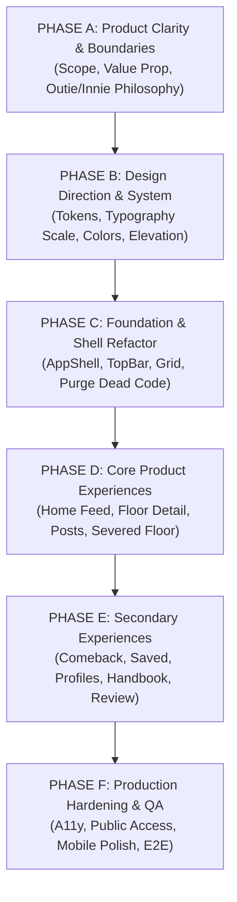

# PRODUCT RECOVERY ROADMAP: LINKEDOUT
**Document Version:** 1.0.0  
**Date:** November 23, 2026  
**Auditor Roles:** Product Manager, Senior Frontend Architect, Principal UX Architect  
**Objective:** A phased, dependency-ordered blueprint to transform LinkedOut from an unstable prototype into a polished, production-grade corporate network.

---

## 1. Phased Architecture Overview



---

## 2. Phase-by-Phase Roadmap

### PHASE A: Product Clarity & Boundaries
*Define exactly what LinkedOut is, eliminate fictional ARG bloat, and solidify the Outie/Innie product contract.*

- **Goals**:
  - Establish LinkedOut as a serious corporate intelligence network, not a TV roleplay game.
  - Solidify "Approach 2: Unified Community, Dual Identity" as the official Outie/Innie strategy.
  - Formally remove out-of-scope features (Rooms, Stories, Refinement game).
- **Deliverables**:
  - Signed-off product specification defining feature boundaries.
  - Formal Outie/Innie persona definitions and cross-mode interaction rules.
  - Revised floor taxonomy: Real company floors for both modes; elimination of fictional Lumon floors.
- **Dependencies**: None. This is the prerequisite for all design and engineering.
- **Risks**: Founder hesitation over letting go of the fictional Severance TV homage elements.
- **Completion Criteria**: Founders and engineering agree on in-scope vs. out-of-scope boundaries.
- **What Must NOT Be Done Yet**: Do not write frontend code, do not tweak CSS, do not redesign UI components.

---

### PHASE B: Design Direction & Design System
*Formalize "The Executive Dossier" direction into concrete design tokens, typography rules, and component specs.*

- **Goals**:
  - Implement full design token suite in `client/src/index.css` via Tailwind v4 `@theme`.
  - Fix broken `.font-head` and `.font-meta` typography definitions.
  - Eradicate root `text-xs` (12px) and establish a production 15px base body scale.
  - Define semantic colors for states, badges, and the Innie/Outie dual palette.
- **Deliverables**:
  - Refactored `index.css` with `@theme` token mappings.
  - Accessible color contrast tokens passing WCAG AA (resolving SeverToggle black-on-teal bug).
  - Formal component specification for Buttons, Inputs, Cards, and Avatars.
- **Dependencies**: Completion of Phase A.
- **Risks**: Introducing visual regressions if component tokens are renamed without a deprecation plan.
- **Completion Criteria**: All color combinations pass WCAG AA; `.font-head` and `.font-meta` classes render correctly in browser; base text size is 14px/15px.
- **What Must NOT Be Done Yet**: Do not overhaul individual pages (Home, Floors, Profile) until the foundational shell is refactored in Phase C.

---

### PHASE C: Foundation & Shell Architecture
*Rebuild the shared layout shell, eliminate the 4-column collision, fix navigation, and purge dead code.*

- **Goals**:
  - Refactor `AppShell.jsx` to enforce standard container widths (`680px` center stream, `240px` left nav, `320px` right rail).
  - Fix the catastrophic 4-column layout bug on FloorPage by passing floor context to `RightRail` instead of nesting duplicate sidebars.
  - Add the `LINKED OUT` letter-spaced brand wordmark to `TopBar.jsx`.
  - Implement mobile search icon and search modal for viewports $<640px$.
  - Purge 30KB+ of dead code (`Navbar.jsx`, `Sidebar.jsx`, `SystemGuideModal.jsx`, etc.).
- **Deliverables**:
  - Unified, responsive `AppShell.jsx` that behaves consistently across 1440px, 1280px, and 390px.
  - Functional mobile search drawer.
  - Cleaned component directory with zero orphaned legacy files.
  - Fixed `TopBar.jsx` with wordmark, SeverToggle colors, and admin navigation link.
- **Dependencies**: Phase B token system.
- **Risks**: Navigation state loss during drawer toggle on mobile.
- **Completion Criteria**: Zero layout collisions on any screen width; mobile search functions smoothly; zero dead files in `client/src/components/`.
- **What Must NOT Be Done Yet**: Do not rewrite post composer or feed algorithms yet.

---

### PHASE D: Core Product Experiences
*Refactor the highest-traffic pages: Home Feed, Floor Detail, Post Discussion, and Severed Floor Ledger.*

- **Goals**:
  - Re-engineer `Home.jsx`: clean tabs (`For You` / `My Floors`), sorting (`New` / `Top`), smooth cursor pagination without stutter.
  - Fix `PostComposer.jsx`: Eliminate `window.location.reload()`; update feed reactively on submit.
  - Re-engineer `FloorPage.jsx`: Render within the unified 3-column shell; provide category chips and member counts.
  - Refactor `PostPage.jsx` & `CommentItem.jsx`: Replace copy-pasted voting arrows with unified `<VoteButtons />`; add cross-mode identity warnings.
  - Refactor `SeveredFloor.jsx`: Add date range filters (`7d | 30d | All`), sorting by headcount, and link layoff rows to company floors.
- **Deliverables**:
  - Polished Home feed with responsive PostCards and reactive composer.
  - Clean Floor detail page without duplicate sidebars.
  - Threaded comment tree with readable mobile margins.
  - Fully featured Severed Floor ledger.
- **Dependencies**: Phase C shell architecture.
- **Risks**: Feed state desynchronization between tabs and active mode.
- **Completion Criteria**: Creating a post updates the feed without page reloads; comment replies do not crush on 390px screens; Severed Floor sparklines do not wrap.
- **What Must NOT Be Done Yet**: Do not start secondary pages (Comeback, Saved, Wellness) until core feed flows are certified.

---

### PHASE E: Secondary Experiences & Feature Activation
*Re-enable Comeback, activate dedicated profile editing, fix Innie profile display, and integrate admin review queue.*

- **Goals**:
  - **Re-enable Comeback (`Comeback.jsx`)**: Replace "Coming soon" screen with functional JobCard grid, filter chips, and "I got hired" Waffle Party trigger.
  - **Fix Profile Management**: Wire `/profile/edit` to the dedicated `EditProfile.jsx` component; remove redundant inline form in `Profile.jsx`.
  - **Fix Innie Profile UX**: Forbid public Innie profile dossier browsing; replace with private Severance Status dashboard.
  - **Activate Admin Review Queue**: Add "Review Queue" link to TopBar user menu for users where `user.isAdmin === true`.
  - **Fix Saved Posts**: Clarify that bookmarks persist across modes or display clear mode tabs.
- **Deliverables**:
  - Working Comeback job directory and celebration flow.
  - Working `/profile/edit` dedicated route.
  - Secure Innie private dashboard.
  - Accessible Admin Review Queue at `/review`.
- **Dependencies**: Phase D core experiences.
- **Risks**: Admin privilege escalation if route guards fail.
- **Completion Criteria**: Admins can access `/review` via UI; users can view jobs and report hiring; `/profile/edit` renders the dedicated form.
- **What Must NOT Be Done Yet**: Do not launch marketing campaigns or open public registration yet.

---

### PHASE F: Production Hardening, Public Access & Final QA
*Open public read-only access, enforce accessibility compliance, optimize performance, and run regression tests.*

- **Goals**:
  - **Public Read-Only Access**: Allow unauthenticated visitors to view `/`, `/floors`, `/floors/:slug`, `/post/:id`, `/severed-floor`, `/handbook`, and `/wellness` with polite "Sign in to contribute" banners.
  - **Return-To Redirect**: Preserve original destination when an unauthenticated user attempts a protected action (e.g. upvoting or posting).
  - **Image Optimization**: Compress `/severance-poster.jpg` from 1.2MB down to $<200KB$ WebP.
  - **Accessibility Compliance**: Verify all focus outlines, ARIA labels, form labels, and color contrast pass WCAG AA.
  - **E2E Testing**: Verify all 7 privacy checks and rate limit tests pass under production build.
- **Deliverables**:
  - Public browsing capability for viral loop growth.
  - Lighthouse Accessibility score $>95$.
  - Optimized static assets bundle.
  - Production readiness sign-off document.
- **Dependencies**: Phases A through E.
- **Risks**: Unauthenticated rate abuse (mitigated by existing IP rate limiters in `server/middleware/limits.js`).
- **Completion Criteria**: 100% of P0 blockers and P1 bugs resolved; all automated privacy and security tests pass; public links render cleanly on social media with OpenGraph metadata.

---

## 3. Prioritized Task Order Summary

```
Task Order:
1. Phase A: Align on Unified Community Dual-Identity & Deprecate ARG TV Floors.
2. Phase B: Configure Tailwind v4 @theme, Fix .font-head & Base Font Scale.
3. Phase C: Rebuild AppShell (Fix 4-Column Collision, Add Brand Name, Mobile Search, Purge 30KB Dead Code).
4. Phase D: Overhaul Home Feed (Reactive Composer, Responsive PostCard, Unified VoteButtons, Severed Ledger).
5. Phase E: Re-enable Comeback Jobs, Route /profile/edit to EditProfile, Fix Innie Profile Blank Title.
6. Phase F: Open Public Read-Only Access, Optimize Assets, Audit WCAG AA.
```
