# UI/UX DEEP AUDIT: LINKEDOUT (PROJECT-SEVERANCE)
**Audit Version:** 1.0.0  
**Date:** November 23, 2026  
**Auditor Roles:** Senior Product Designer, Principal UX Architect, Design Systems Engineer  
**Inspection Scope:** All rendered page layouts, Tailwind utility configurations, typography hierarchy, responsive breakpoints (1440px, 1280px, 390px), interactive components, and visual identity.

---

## 1. Overall Visual Assessment: "Half-Built Terminal Meets Fragmented Cards"

LinkedOut's visual presentation sits in an awkward, unresolved space between a retro-futuristic Severance computer terminal and a standard modern web forum:
1. **The Terminal Identity is Incomplete**:
   - The fonts (`IBM Plex Sans` and `IBM Plex Mono`), the mono caps section tags (`// SEVERED THIS MONTH`), and the subtle corner ticks on cards are visually striking and distinct.
   - However, the execution falls apart because modern generic card patterns, inconsistent borders, and jarring light/dark mode inversions break the illusion.
2. **Typography Degradation**:
   - The root container of almost every page sets `text-xs` (12px). This creates an unnaturally shrunken interface where headers, body text, buttons, and metadata fight inside tiny 12px containers, while certain children unpredictably break out using arbitrary inline pixels (`text-[14px]`, `text-[15px]`, `text-[17px]`).
3. **Severe Density Discrepancies**:
   - On wide desktop viewports (1440px+), the AppShell leaves gaping empty gutters inside the center feed column because center page containers are hardcoded to `max-w-2xl` (672px) or `max-w-3xl` (768px).
   - At the same time, the `RightRail` is cramped into a rigid 260px column where 42px numbers and text collide awkwardly.
4. **Card Overuse**:
   - Every single element on the page—onboarding items, post items, layoff items, directory items, forms, comments, and side modules—is wrapped in an identical bordered card (`bg-[var(--surface)] border border-[var(--border)] rounded-[var(--radius)]`). There is zero surface hierarchy or elevation differentiation.

---

## 2. Route-by-Route Visual & UX Issues

### 2.1 TopBar & Global Navigation (`TopBar.jsx`)
- **Missing Brand Text**: `TopBar.jsx#L99-L105` renders only `<LinkedOutLogo />`, which is an `` tag of the door. The actual platform name "LINKED OUT" is nowhere to be found in the header! A user looking at the top bar sees only a tiny gold or green door with no text.
- **Mobile Search Disappearance**: The search input container has `className="... hidden sm:block"` (`TopBar.jsx#L108`). On mobile viewports ($<640px$), the search box is completely removed with no search button, icon, or drawer substitute. Mobile users cannot search.
- **Misaligned Dropdown Search Results**: The search results dropdown uses `absolute top-10` with a fixed `z-50 max-h-80`. In narrow laptop viewports, the search dropdown overflows into the center feed without an overlay backdrop.
- **SeverToggle Hardcoded Black Background**: In Innie mode (light mint background), the SeverToggle track has `bg-zinc-900 border-zinc-700` (`SeverToggle.jsx#L15`), creating a harsh pitch-black rectangle that clashes with the sterile mint header.
- **Undefined Accent Variable**: `SeverToggle.jsx#L20` uses `text-[var(--accent-fg,#000)]`. `--accent-fg` does not exist in `index.css`, falling back to `#000` (black). Black text on Innie's dark teal `#2D6F63` fails WCAG AA contrast (ratio: 3.9:1).

---

### 2.2 Left Navigation (`LeftNav.jsx`)
- **Rigid Sticky Height**: LeftNav uses `sticky top-14 overflow-y-auto`. When a user joins more than 6 floors, the "Your Floors" list causes a secondary scrollbar to appear right inside the navigation column.
- **Duplicate Navigation Targets**: LeftNav lists "Home, Floors, Severed Floor, Comeback, Saved". At the same time, the mobile tab bar lists "Home, Floors, Severed, Comeback, Profile". The wording changes arbitrarily ("Severed Floor" vs "Severed"), and "Saved" is in desktop LeftNav while "Profile" is in mobile bottom bar.
- **Redundant Links**: The footer in `LeftNav.jsx#L127-L150` lists `Handbook`, `Wellness`, and `Privacy` (which just links to `/handbook`).

---

### 2.3 Right Rail (`RightRail.jsx`)
- **Stat Label Misalignment**: In `RightRail.jsx#L98-L108`, the 42px stat `{overview.severedThisMonth}` sits above a UTF-8 sparkline. But if `severedByDay` is empty or loading, the container collapses vertically, causing layout jitter.
- **Join Button Inconsistency**: Suggested floors in the right rail use `size="xs"` outline buttons. When joined, they flip to a static text label `<Check /> Joined`, while on `/floors`, joined floors show a clickable `size="sm"` button that toggles leave.

---

### 2.4 Center Feed & Home (`Home.jsx`)
- **The "Load More" Cursor Stutter**: When clicking "Load more" at the bottom of the feed, new items are appended via `setPosts((prev) => [...prev, ...items])`. Because `PostCard` has no skeleton placeholder or smooth list transitions, the entire feed abruptly jumps down by several hundred pixels.
- **Filter Tabs Collision**: The tabs ("For you" vs "My floors") and the sort selector ("New" vs "Top") sit on the exact same row (`Home.jsx#L82-L132`). On mobile screens ($390px$), this row wraps awkwardly, pushing the "Top" button onto a second line.
- **Dead Component Reminder**: `FloorsRow.jsx` (Instagram-style stories bar) was designed to sit at the top of Home, but was never connected.

---

### 2.5 Floor Page Layout Collision (`FloorPage.jsx`)
- **The 4-Column Grid Collision**:
  - `AppShell.jsx` desktop grid: LeftNav (260px) + Center Column + RightRail (260px).
  - Inside Center Column, `FloorPage.jsx#L93` specifies: `
`.
  - On a 1440px desktop screen, this forces:
    1. LeftNav (260px)
    2. Floor Feed (~550px)
    3. FloorPage Inner Sidebar (280px)
    4. AppShell RightRail (260px)
  - This results in **two competing sidebars side-by-side**, both showing "About", "Member counts", and "Rules"! It is a critical visual and structural failure.

---

### 2.6 Post Detail Page (`PostPage.jsx`)
- **Unstyled Modal Form Inputs**: In `PostPage.jsx#L316-L332`, the "Edit Post" modal uses raw, unstyled HTML `<input>` and `<textarea>` elements with hardcoded inline focus classes instead of using the `@/components/ui/input` and `@/components/ui/textarea` primitives.
- **Copy-Paste Vote Buttons**: `PostPage.jsx#L217-L234` manually duplicates the full JSX markup of `ArrowBigUp`, score, and `ArrowBigDown` instead of importing `<VoteButtons />`.
- **Indentation Fragility**: Comment replies use `ml-6 sm:ml-8 pl-3 border-l border-[var(--border)]` (`CommentItem.jsx#L283`). On mobile screens ($390px$), nested replies compress the comment body down to less than 240px wide, causing severe word-wrap and awkward 2-word lines.

---

### 2.7 Severed Floor Ledger (`SeveredFloor.jsx`)
- **Sparkline Wrapping Bug**: In `SeveredFloor.jsx#L96`, `renderSparkline` outputs a 30-character Unicode string. On mobile devices with larger default system fonts, this string overflows or wraps onto two lines, breaking the continuous sparkline visual.
- **Search and Add Alignment**: The search input and "+ Add report" button are placed inside a flex row (`SeveredFloor.jsx#L103-L116`). On 390px mobile viewports, the search input shrinks so much that the placeholder "Search company records" is clipped to "Search com...".

---

### 2.8 Personnel Profile (`Profile.jsx`)
- **Empty Identity Bug in Innie Mode**:
  - When in Innie mode, `Profile.jsx#L109-L111` sets `displayName = profile.innieHandle`.
  - However, `GET /api/users/:username` **deliberately strips `innieHandle`** from public responses to prevent de-anonymization.
  - As a result, when viewing any user's profile in Innie mode, the `<h1>` header is **completely empty**!
- **Hardcoded Innie Department**:
  - Line 155-159 hardcodes the string `"Macrodata Refinement & General Floors"` for *every single user* when viewed in Innie mode, regardless of who they are or what floors they belong to!
- **Duplicate Form Logic**: `Profile.jsx` contains 100 lines of inline edit form logic (`name, username, avatar, headline, bio, status`), while `EditProfile.jsx` sits in the repo doing the exact same thing in isolation.

---

## 3. Responsive Breakpoint Analysis

| Element / Route | Desktop (1440px) | Laptop (1280px) | Mobile (390px) | Verdict |
| :--- | :--- | :--- | :--- | :--- |
| **Global TopBar** | Spaced evenly; Search visible; SeverToggle accessible. | Good; Search width reduces slightly. | **Broken**: Search bar disappears completely (`hidden sm:block`). No search icon. | **Severe Mobile Defect** |
| **Shell Grid** | 3 columns: 260px / 848px / 260px. Center feed floating awkwardly. | 3 columns: 260px / 728px / 260px. Proportions feel tight. | 1 column: LeftNav & RightRail hidden. Bottom tab bar active. | Acceptable |
| **Center Feed** | Constrained to `max-w-3xl` (768px), leaving 80px empty gutters. | Fills 100% of available 728px center column. | Fills 100% with `px-4`. Post titles wrap nicely. | Inconsistent Widths |
| **Floor Detail Page** | **4-Column Collision**: Double sidebars side-by-side. | Severe crowding; inner aside squeezes feed to 400px. | Inner aside collapses below feed; acceptable on mobile. | **Critical Desktop Blocker** |
| **Severed Sparkline** | 30-day Unicode sparkline renders cleanly on 1 line. | Clean on 1 line. | Wraps or truncates depending on font scaling. | Minor Glitch |
| **Modals (Composer/Report)**| Centered modal with backdrop blur; comfortable width. | Comfortable width. | Can overflow vertically when mobile keyboard opens. | UX Friction |

---

## 4. Design Inconsistencies & Systemic Root Causes

The problems observed across the application are not isolated bugs. They stem from **7 systemic architectural root causes**:

```mermaid
flowchart TD
    RC1["Root Cause 1: Missing Page Templates"] --> S1["Inconsistent container widths (max-w-xl, max-w-2xl, max-w-3xl, max-w-4xl)"]
    RC1 --> S2["FloorPage 4-column layout collision"]
    
    RC2["Root Cause 2: Base text-xs Degradation"] --> S3["Microscopic 12px text across all screens"]
    RC2 --> S4["Chaotic inline pixel overrides (text-[14px], text-[17px])"]
    
    RC3["Root Cause 3: Broken Typography Mapping"] --> S5[".font-head and .font-meta classes do not exist in CSS"]
    RC3 --> S6["Headers fail to render in IBM Plex Mono/Head font"]
    
    RC4["Root Cause 4: Component Duplication & Dead Code"] --> S7["35KB+ of unused components (Navbar, Sidebar, SystemGuideModal)"]
    RC4 --> S8["Triple duplication of voting arrow markup"]
    
    RC5["Root Cause 5: Innie / Outie Identity Schizophrenia"] --> S9["ARG roleplay floors vs real corporate forum"]
    RC5 --> S10["Blank username in Innie profile view"]
    RC5 --> S11["Cross-mode commenting with no guardrails"]
    
    RC6["Root Cause 6: Desktop-First Mobile Breakage"] --> S12["Search bar completely missing on mobile"]
    RC6 --> S13["Nested comment tree crushed on 390px screens"]
    
    RC7["Root Cause 7: Total Unauthenticated Lockout"] --> S14["Public cannot view layoff ledger or shared posts"]
    RC7 --> S15["Zero viral loop, destroyed social previews"]
```

---

## 5. Severity & Priority Matrix

| Issue | Location | Root Cause | Severity | Priority | Recommended Action |
| :--- | :--- | :--- | :---: | :---: | :--- |
| **4-Column Layout Collision** | `FloorPage.jsx#L93` | RC1: Missing Page Templates | **BLOCKER** | **P0** | Eliminate inner `<aside>` in `FloorPage.jsx`; pass floor context up to AppShell's `RightRail`. |
| **Blank Innie Profile Name** | `Profile.jsx#L109` | RC5: Identity Schizophrenia | **BLOCKER** | **P0** | Forbid Innie profile dossier browsing; redirect Innie profile visits or display private status view. |
| **Search Missing on Mobile** | `TopBar.jsx#L108` | RC6: Desktop-First Breakage | **HIGH** | **P0** | Add mobile search icon button that triggers a dedicated search modal/drawer. |
| **Missing Brand Name Text** | `TopBar.jsx#L99` | Design Identity Neglect | **HIGH** | **P1** | Add letter-spaced `LINKED OUT` monospace wordmark next to door icon in TopBar. |
| **Base `text-xs` Degradation** | `Home.jsx`, `Floors.jsx`, etc. | RC2: Base text-xs Degradation| **HIGH** | **P1** | Set base body text to 14px/15px (`text-sm`), reserving `text-xs` strictly for metadata/timestamps. |
| **Broken `.font-head` Utility**| `index.css`, all components | RC3: Broken Typography Mapping| **HIGH** | **P1** | Define `@theme { --font-head: ...; --font-meta: ...; }` in Tailwind v4 so font classes function. |
| **SeverToggle Innie Color Bug**| `SeverToggle.jsx#L15,L20` | CSS Variable Disconnect | **MEDIUM** | **P1** | Remove hardcoded `bg-zinc-900`; map thumb text to `--accent-ink` instead of undefined `--accent-fg`. |
| **Comeback Page Disabled** | `Comeback.jsx#L19` | Abandoned Step 9 Implementation| **HIGH** | **P1** | Re-enable Comeback job cards grid and "I got hired" reintegration announcements. |
| **Dead Code Accumulation** | `client/src/components/` | RC4: Component Duplication | **MEDIUM** | **P2** | Purge unused legacy files (`Navbar.jsx`, `Sidebar.jsx`, `SystemGuideModal.jsx`, etc.). |
| **Full Page Reload on Post** | `AppShell.jsx#L81` | SPA State Mismanagement | **MEDIUM** | **P2** | Replace `window.location.reload()` with reactive state updates or React Router revalidation. |
